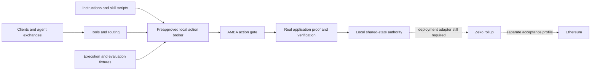

# AAIF ecosystem: local demos with verifiable shared state

Ten project folders show how the [current AAIF suite](https://aaif.io/projects) can participate in workflows using Zeko's application-state model. The common benefit is bounded authority and a shared, checkable record of resource consumption and accepted commitments across different clients and services.

The suite runs locally without a hosted model, commercial identity provider, wallet, funded transaction, deployed rollup or container cluster. Setup downloads pinned open-source dependencies. Runtime requests stay on loopback. The full native reference run is supported on **macOS arm64, Node.js 24 and Python 3.12+**.

## Run the suite

```sh
npm ci --ignore-scripts
npm run ecosystem:setup
npm run ecosystem:demo
npm run ecosystem:proofs -- --report evidence/ecosystem-run-local.json
```

For one project, add `-- --project mcp` to the demo or proof command. See the [runbook](RUNBOOK.md) for setup, isolation, evidence and limitations.

## Project-by-project coverage

| Project | What actually executes | Benefit exercised |
| --- | --- | --- |
| [MCP](mcp/README.md) | Official SDK clients and server; concurrent resource calls | Two clients cannot spend the same remaining quota; replay cannot dispatch again |
| [A2A](a2a/README.md) | Official SDK v1 JSON-RPC client/server | An agent exchange can carry an action backed by one accepted commitment |
| [goose](goose/README.md) | Native goose CLI and real MCP extension; deterministic local model fixture | An agent client uses a bounded task and receives state evidence without a hosted model |
| [agentgateway](agentgateway/README.md) | Native gateway routing MCP traffic to the local broker | Routing preserves the common action gate; changed requests and replay are rejected |
| [Agent Router](agent-router/README.md) | Native `aigw` plus Envoy, routing local model and MCP requests | The control plane can expose the same stateful tool while sharing authoritative quota |
| [Open Responses](open-responses/README.md) | Official schema validation and local non-streaming function-call exchange | Tool call IDs and accepted receipts remain correlated; changed call IDs fail |
| [OpenSandbox](opensandbox/README.md) | Official Python SDK with an in-memory control-plane/execd transport fixture | Lifecycle/command result handling connects to one accepted action; no container isolation is claimed |
| [OpenEnv](openenv/README.md) | Official typed Environment implemented in process | An episode reset cannot replenish an independently held shared budget |
| [Agent Skills](agent-skills/README.md) | Official reference validator and an executable packaged skill script | Reusable instructions and tooling consume existing authority rather than granting it |
| [AGENTS.md](agents-md/README.md) | Workspace instructions with an executable companion scenario | Coding-agent instructions describe the same bounded action and receipt workflow |

These are selected integration examples, not certification of every feature or production configuration. OpenSandbox's service is a fixture; OpenEnv is an in-process environment. Agent Skills and AGENTS.md are instruction formats, not settlement engines. The evidence records these distinctions rather than treating all ten as equivalent runtime tests.

## One shared application boundary

Each scenario uses the same backend and state profile. Canonical AMBA OAuth and ID-JAG run against a synthetic local provider. A trusted test approver creates a mission and exact action before a client runs. The loopback broker accepts only those preapproved action IDs and units, then invokes the authenticated MCP/AMBA backend. It is test orchestration, not an enterprise identity broker implementation.



A successful action returns a receipt containing its domain/action commitment, state version and remaining quota. Proof mode adds a real o1js reservation proof. The circuit proves quota arithmetic and version advancement with public domain/action commitments; AMBA authorization is checked separately by the service. Proofs and sandbox receipts do not establish canonical Zeko core state or Ethereum finality.

## Technical Committee question

The examples demonstrate a practical integration seam: different agent interfaces can use the same bounded state action while preserving their own client, transport, routing, execution or instruction role. Observable benefits are rejected duplicate/changed actions, consistent resource accounting and correlated result evidence. These results do not establish improved model quality, lower cost or production adoption for every upstream implementation.

The next deployment milestone is a pinned adapter that replaces local state acceptance with a core Zeko application/sequencer/DA path. Ethereum verification/settlement is a separately tested profile. The local suite makes that boundary explicit while giving implementers useful code and fixtures now.

Sources and pins: [component versions](versions.json), [binary checksums](binaries.json), [Python lock](requirements.lock), [current evidence](../evidence/README.md), [compatibility matrix](../compatibility.md). This folder does not expand the focused working-group outreach campaign.
