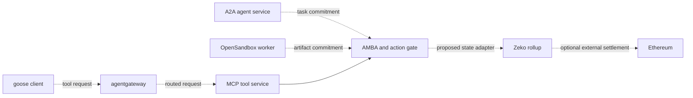

# How AAIF projects connect to Zeko

Zeko's proposed role is **verifiable shared state across agent applications**. Existing agent interfaces, clients, gateways and execution environments supply complementary parts of a workflow. This folder shows the strongest connections and the practical work needed to demonstrate each one.

Project roles were checked against the [AAIF project roster](https://aaif.io/projects) and the upstream sources linked in each guide on 26 October 2026. The integration designs below are Zeko proposals based on those interfaces. They are not claims of adoption by the upstream projects.

## Strongest connections

| Project | Where it connects | What Zeko could add | Evidence today |
| --- | --- | --- | --- |
| [MCP](mcp.md) | Tool calls that create or consume application state | Proof-backed resource reservations and checkable state receipts | Official SDK client/server runs in the local sandbox |
| [goose](goose.md) | A person delegates work to an agent using MCP tools | A shared budget or commitment that multiple services can verify | Proposed; goose has not been run against this service |
| [agentgateway](agentgateway.md) | Routing and authenticated access to the stateful tool service | Common action/state acceptance across routed requests | Proposed; gateway route and identity propagation need testing |
| [A2A](a2a.md) | Work delegated between independently operated agents | Shared commitments and accepted outcomes bound to task/artifact references | Proposed; task-to-state binding needs implementation |
| [OpenSandbox](opensandbox.md) | Agent work executed in operator-controlled environments | Verifiable commitments linking approved work, artifacts and accepted application state | Proposed; no OpenSandbox integration run yet |

The current runnable path is **MCP → AMBA checks → real application proof → local state acceptance**. It uses ID-JAG/resource access tokens, a synthetic identity provider and a local single-writer authority. It does not currently submit application state to a deployed core rollup or settle it on Ethereum. See [sandbox scope](../sandbox/README.md) and [reproducible evidence](../evidence/README.md).

## How the pieces fit

The diagram shows the proposed deployed path. Dashed connections require additional integration work; it is not a diagram of an already demonstrated deployment.

These components can also be used separately. A direct MCP client need not adopt the gateway, A2A or OpenSandbox to use a stateful tool.

## Sovereignty and benefit

An enterprise or agent operator can aim to choose its client, model, identity provider, execution environment and rollup operator while retaining a common application-state interface. Zeko could make budgets, resource reservations and commitments independently checkable across those choices. Privacy depends on the selected data flow and proof statement; the existing reservation example has public proof fields.

Applications select when acceptance is sufficient: a valid proof, authoritative rollup acceptance and Ethereum finality are distinct conditions. Project software itself does not automatically “settle to Zeko.” Each guide identifies the application state that would be recorded and the service that enforces it.

## Work sequence

1. Replace the sandbox's local state adapter with a pinned Zeko application/core deployment and independently check its accepted receipts.
2. Exercise goose as a real client, then agentgateway as a routing path, against the same profile. Document the authentication each actually supports.
3. Add an A2A task/artifact scenario and an OpenSandbox execution example as separate integration profiles.
4. Record an Ethereum verification/settlement profile separately, using the actual verifier configuration deployed.

For each integration, record component versions, configuration without secrets, the authorized action, accepted state/receipt and rejection/recovery behavior. Passing the existing local fixtures does not replace running the added component.

The remaining five hosted projects have [supporting connections](other-projects.md). The [compatibility matrix](../compatibility.md) is the implementation-status checklist. This folder is a technical map, not an expanded working-group outreach schedule.
